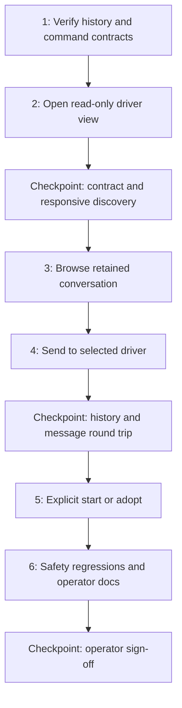

# Implementation Plan: Orchestrator Driver Conversation in Task Timer

## Overview

Add a keyboard-operated Orchestrator view to the Rust task-timer TUI so Amin can read the persistent driver's conversation, see new replies and automated attention wakes, and send instructions to that same driver. Task-timer is a client, not a second orchestrator. Preserve timer, Jira, Kanban, and worker-agent behavior. Amin approved implementation with the integration amendment below.

Task list target: [`tasks/todo.md`](todo.md). Existing `docs/tui/tasks.md` is the historical cross-app epic checklist and remains unchanged; this feature is TUI-only. Neither `tasks/plan.md` nor `tasks/todo.md` existed when this plan was created.

### Approved integration amendment (2026-10-19)

Amin approved a Node adapter over the public `@getpaseo/client` SDK. Bundle the adapter into the Rust binary at build time; require the Node runtime at execution, and never import Paseo's private nested CLI modules or depend on a globally installed SDK path. This intentionally amends the original no-new-dependency assumption. The official SDK owns structured timeline paging; exact-target message sends remain a direct `paseo send --no-wait --json <id> --prompt <text>` call with no fallback.

## Current Evidence

Inspected 2026-10-19:

- Project: `/home/amin/projects/tauri/tauri-task-timer`.
- `apps/tui/src/app/mod.rs`: `AppMode` currently has Daily, Archive, and Kanban; `App::handle_key` routes modal and mode-specific input. The main loop polls every 250 ms and reloads once per second. Its non-Daily branch currently calls `reload_archive`; explicitly exclude the new mode from that branch.
- `apps/tui/src/ui/mod.rs`: central render dispatch. `apps/tui/src/app/keymap.rs`: existing keyboard help. Uppercase `O` is unused in the inspected mode handlers; lowercase `o` opens Jira and must keep doing so outside the new view.
- `apps/tui/src/kanban.rs`: existing argv-based external-command integration. Its blocking `Command::output()` pattern must not run on the render/input thread for conversation operations.
- `apps/tui/src/main.rs`: crate module registration. Existing dependencies include serde, serde_json, reqwest, ratatui, and crossterm. The approved adapter adds a public Paseo SDK build dependency and Node runtime requirement.
- `apps/tui/src/db/integrations.rs` and `ui/timer_view.rs`: task-level agent badges already exist. They are not the global driver's identity or transcript and must not be repurposed.
- `package.json`: `pnpm build:tui` runs `cargo build -p task-timer-tui --release`; focused Rust checks can use `cargo test -p task-timer-tui`.
- `/home/amin/.agents/scripts/orchestrator_run.py`: `_driver_ls_ids()` discovers agents using `paseo ls -g --label orchestrator.role=driver --json`; `driver_start()` adopts an existing matching agent or creates one. `driver_send()` returns an agent ID, not a response or message acknowledgment ID, and may retry against another labeled agent after failure.
- Read-only live discovery returned one labeled driver, with status `idle`. This is availability evidence, not evidence of successful messaging.
- Installed `paseo logs --help` advertises `--tail`, `--since`, `--follow`, and `--json`. A real `paseo logs <driver-id> --tail 6 --json` returned rendered `[Thought]`/`[Shell]` entries and assistant text, not JSON. User-message coverage, stable event identity, ordering, pagination, and wake coverage remain unverified. Do not infer a transcript schema from this output.
- The task-timer TokenSave graph was approximately 24 hours old; decisive UI and command findings above were checked against live source. No graph sync or application mutation was performed.

## Architecture Decisions

1. **One Orchestrator mode.** Add `AppMode::Orchestrator`, entered with `O` from non-modal Daily, Archive, or Kanban. Restore the originating mode on exit. Keep navigation keys out of the composer and preserve existing timer shortcuts elsewhere.
2. **Paseo remains the history owner.** Read retained history through a small Node adapter bundled into the Rust TUI and built against the public `@getpaseo/client` SDK. No new SQLite table, copied transcript database, direct private-store reads, or custom orchestration service. Runtime requires Node.
3. **Resolve before sending.** Discover labeled drivers read-only on entry. Zero matches gives a disconnected view with an explicit Start/adopt action. Multiple matches require explicit selection; never silently choose the first agent. Show the full selected ID and status. Driver replacement resets the transcript context rather than combining unrelated histories.
4. **Address the visible driver exactly.** Send using the existing `paseo send --no-wait --json <selected-id> --prompt <message>` interface after Task 1 verifies its acceptance semantics. Do not use the current `driver-send` wrapper for the composer: its fallback can silently target another agent or repeat an ambiguously delivered instruction. A stale target requires rediscovery and a user decision before another send.
5. **Explicit lifecycle action only.** Start/adopt uses the existing `orchestrator-run driver-start`, never `paseo run` from task-timer. Opening, refreshing, and reading history must not start a driver, resume the runner, dispatch tickets, or transition Jira. The task-timer client never writes orchestrator state or events files.
6. **Keep the UI responsive.** Use one small owned background worker and stdlib channels for command work. UI state stays on the UI thread. Bundle the Node SDK adapter into the binary, invoke it off-thread, and bound requests, command duration, captured output, and in-flight work. Stop/reap child processes and workers on exit. Poll only while the view is active (initial proposal: every 2 seconds after completion, with no overlapping fetches). Do not add an async runtime or general job framework.
7. **Honest delivery states.** Track draft, sending, accepted, failed, and delivery-unknown separately from driver activity. A command acknowledgment is not a reply or proof of task completion. No automatic resend after timeout, disconnect, or malformed success output. Preserve draft text on failure/unknown delivery; disable duplicate submission while sending. Correlate with history only if the transport has real identifiers; text equality cannot deduplicate intentional repeated messages.
8. **Untrusted transcript content.** Treat messages/tool output as display data. Do not execute content, emit raw terminal control sequences, or auto-approve permission requests. If the history API exposes attention/permission state, show it with an explicit instruction to use the existing Paseo approval surface; no approval UI is in scope.

## User Interaction Contract

- Header: selected driver identity, Paseo status verbatim, connection/history-fetch state, and last successful refresh. Never label `idle` as completed or imply runner activity from driver activity.
- History: previous retained human messages and driver replies, including automated wake prompts where the supported source records them. Initial bounded window plus explicit older-history loading; a tail-only display does not meet acceptance. Clearly identify any retention limit reported by the source. Tools/thoughts may be collapsed but are never mislabeled as user or assistant messages.
- Navigation: `Tab` switches history/composer focus; history supports scrolling and older-history loading without snapping to the bottom on refresh. Follow new output only when already at the bottom. `r` refreshes only in history focus.
- Compose: Unicode-safe multiline input and paste; `Enter` inserts a newline, `Ctrl+S` submits once. Typing `q`, `r`, `O`, or spaces in the composer must not trigger navigation or timer actions.
- Exit: `Esc` leaves the composer for history, then returns to the originating mode; `q` exits the Orchestrator view only in history focus. Retain the draft while switching modes within this process. An application quit with a nonempty draft or in-flight send warns before discarding local text/observation; exiting never resends. No cross-restart draft persistence is planned.
- Start/adopt: only from a disconnected view, via a clearly labeled confirmation explaining that starting the driver sends its bootstrap prompt and can initiate agent activity under its existing contract. No automatic daemon startup.
- Errors: missing CLI, unavailable daemon, stale/ambiguous identity, invalid history payload, timeout, and truncated output are visible persistent view states; last successful history remains visibly stale rather than disappearing.

## Dependency Graph

## Task List

### Phase 1: Contract and Read-only Access
- [ ] Task 1: Prove the Paseo history and delivery contract.
- [ ] Task 2: Open a responsive read-only driver view.
- [ ] Checkpoint A: History transport is viable; discovery does not mutate orchestration state.

### Phase 2: Conversation
- [ ] Task 3: Browse retained conversation and new replies.
- [ ] Task 4: Send one instruction to the selected driver.
- [ ] Checkpoint B: History survives reopening and messaging has honest delivery feedback.

### Phase 3: Lifecycle and Completion
- [ ] Task 5: Explicitly start or adopt a missing driver.
- [ ] Task 6: Finish operator help and safety regression coverage.
- [ ] Checkpoint C: All acceptance criteria demonstrated and human approval recorded.

Full descriptions, acceptance criteria, verification commands, dependencies, and file bounds are in `todo.md`. The index above is not a second task tracker.

## Verification Strategy

- Contract verification preceded implementation. Implementation checks are hermetic with temporary HOME/config/database and fake adapter/processes; never use real Jira, Bitbucket, the production driver, or a user's timer database in tests.
- Implementation: unit tests for consumer-visible SDK normalization, transcript ordering/pagination, delivery ambiguity, stale responses, and input precedence. Keep checks hermetic with temporary HOME/config/database and fake adapter/CLI processes; never use real Jira, Bitbucket, the production driver, or a user's timer database in tests.
- Focused commands planned: `cargo test -p task-timer-tui orchestrator`; `cargo build -p task-timer-tui`. Final checkpoint: `cargo test -p task-timer-tui` and `pnpm build:tui`. These are future verification steps, not results.
- Actual TUI proof is required, not only tests: open the built binary against a throwaway DB/config in an interactive terminal, exercise keyboard input/history/resize/disconnection and delayed commands, and observe a running throwaway timer stay responsive. Use `target/debug/task-timer-tui --config <temporary-config>`; never launch the installed production TUI for regression checks.
- A live round trip is a separately authorized operator check: Amin chooses the exact driver/message, for example a status-only question explicitly prohibiting mutations. Confirm message and reply in both Paseo history and the TUI. No automated tests may send to the production driver.
- Docs after behavioral proof: update `apps/tui/README.md` and keyboard help with actual commands, limitations, and delivery meanings. Web/MCP/schema documentation intentionally unchanged because their behavior is unchanged.

## Scope Boundaries

Not building: another runner, a general agent dashboard, worker management, queue controls, Jira transition shortcuts, a new database/API, provider selection, speech, permissions approvals, cross-session transcript search, archived-driver conversation aggregation, or web/desktop/MCP parity. Selected-ticket insertion is optional future work, not required to talk to the global driver.

History and direct messaging are both required. If supported Paseo interfaces cannot supply retained user/assistant history and older entries, stop at the contract gate and request a decision about an upstream fix or supported interface change. Do not silently ship a rendered-log tail as a chat replacement.

## Risks and Mitigations

| Risk | Impact | Mitigation |
|---|---|---|
| Logs advertise JSON but emit text; user prompts/older entries may be unavailable | High | Task 1 is a hard gate; inspect supported CLI/API contracts and verify real read-only responses before building the history viewer. |
| Ambiguous command delivery or fallback targets another agent | High | Address the displayed agent directly; no client resend/fallback; preserve unknown-delivery state and draft. |
| Blocking subprocess freezes timers/input or leaks children | High | Owned worker, bounded requests/time/output, cleanup, and actual delayed-command TUI smoke. |
| Driver ID changes while history/send is in flight | High | Tag each request with selected identity/generation; discard stale results and require explicit target reselection for further sending. |
| Existing reload/key handling spills into Orchestrator mode | Medium | Explicit mode handling; composer before global shortcuts; regression checks for Daily/Archive/Kanban and hook/timer cadence. |
| Transcript exposes control sequences or permission text | Medium | Render safe text; keep roles truthful; no execution/approval paths. |
| History grows or refresh repeats pages | Medium | Transport-supported ordering/cursors, bounded loaded pages, visible load-older controls; never deduplicate by message text. |
| Read-only view accidentally starts or resumes work | High | No start on entry/reconnect; explicit lifecycle confirmation; tests observe command effects rather than source strings. |

## Open Questions and Decision Gates

1. **Resolved:** installed Paseo exposes retained typed timeline pages and cursors through the public TypeScript SDK; `paseo logs --json` is rendered text and is not the history API. See `docs/tui/orchestrator-contract.md`.
2. The `--no-wait` send acknowledgment reports `sent` after the daemon call returns. A post-dispatch timeout/nonzero result may be ambiguous; no live send has been authorized or performed.
3. Partial streaming and attention are separate capabilities. Render only typed history/attention fields that the adapter proves; do not mark a partial stream complete.
4. Amin approved the Node SDK adapter amendment on 2026-10-19. Final feature/operator sign-off remains required before shipping; production-driver round trip remains separately authorized.

## Parallelization

Implement sequentially: tasks share the driver/transport contract and application state. Once Task 1 freezes the contract, isolated transport behavior checks and rendering work can proceed concurrently only with one integration owner and agreed state types. This thin feature does not require parallel implementation by default.
